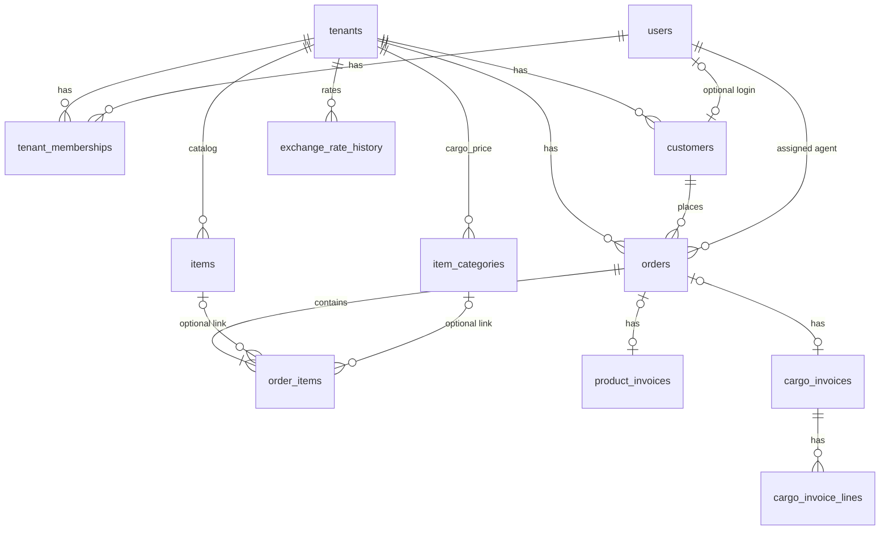

# Order4U database design

PostgreSQL via Prisma. Source of truth: [`prisma/schema.prisma`](../prisma/schema.prisma). Tables use snake_case (`@@map`). IDs are UUIDs.

Deploy with `npx prisma db push` (no migration history in the repo yet). After a schema push that adds customer PII columns, run `npm run db:encrypt-pii`.

## Tenancy

One **shop** is a `tenants` row. Agents, cargo staff, and customers belong through `tenant_memberships` (`role`: `agent` | `cargo` | `admin` | `customer`). Almost every business table has `tenant_id`. Login identity is `users` (email + password hash); a customer profile is a separate `customers` row, optionally linked with `customers.user_id`.

## Tables

### `tenants`

Shop settings: name, `slug`, default agent, Messenger page id, public order form flag, **current** THB→MMK rate, default service-fee %, payment instructions.

The live rate is `default_thb_mmk_rate`. Past rates go to `exchange_rate_history`; each **product invoice** also copies the rate at create (`product_invoices.rate_thb_mmk`).

### `users`

Staff and customer logins. `email` is unique globally (Auth.js identity). `must_change_password` is set when an agent creates or resets a customer password; middleware sends that customer to `/customer/change-password` until they pick a new one.

### `tenant_memberships`

Composite PK `(tenant_id, user_id, role)`. Same person can theoretically hold more than one role; sign-in picks the first membership (`agent` / `cargo` / `customer` order).

### `customers`

Shop-facing person. **Plaintext:** `name` (search), `created_at`. **Encrypted at rest** (AES-256-GCM, `CUSTOMER_PII_KEY`): `phone`, `email`, `facebook_profile_url`, `notes`, `messenger_psid`. Ciphertext format: `enc:v1:<iv>:<tag>:<data>` (base64).

Lookups without decrypting:

- `phone_hash` — HMAC-SHA256 of normalized digits (index with `tenant_id`; not unique, dummy phones share a hash)
- `email_hash` — HMAC-SHA256 of trimmed lowercase email (empty when no email)
- `messenger_psid_hash` — unique per tenant when set
- login `users.email` — plaintext; directory search uses `contains` on this plus exact `email_hash` / `phone_hash`

Agent customer list is paginated in the query (`skip`/`take`); sort uses `name`, `orders._count`, or `created_at`. Existing rows without a real create time are backfilled from the earliest related order when possible.

`portal_access_token` is an unguessable public-order link, stored plaintext. `user_id` is set only when the customer has a login.

Decrypt only in server queries/mappers. Agent UI shows plaintext to the signed-in agent.

### `items` (catalog)

Reusable product lines for the agent order form (name, URL, default quoted THB). Linked from `order_items.catalog_item_id` when the agent picked a catalog row.

### `item_categories`

Cargo price list (THB per unit of the category). Assigned on a line when cargo invoices.

### `orders`

One job for one customer, assigned to one agent. Status is split:

| Column | Meaning |
|---|---|
| `fulfillment_status` | Physical path (buying → cargo → Myanmar) |
| `product_payment_status` | Customer paid for goods (`awaiting` / `paid`) |
| `cargo_payment_status` | Cargo invoice (`not_applicable` until invoiced) |

`code` is unique per tenant (e.g. `ORD-…`). `public_access_token` is the customer tracking URL. `created_by_user_id` is set when a signed-in customer places the order.

### `order_items`

Quoted `price` (THB per unit, on the customer invoice). `actual_price` is what the agent paid (THB per unit) — agent-only; reports **item profit** = `(price − actual_price) × qty`. Not stored; computed in the reports query.

`customer_note` is product options (plaintext, not PII). `marketplace` is `shopee` | `lazada` | `other`.

Same catalog product on many orders stays **many rows**. Reports do not roll up by name/URL.

### `product_invoices`

One per order, created on submit. Snapshot of THB goods + Thai shipping, service fee %, FX, MMK due. Rate is copied from shop settings at create (buy-before-pay / lock-at-paid is parked in `BACKLOG.md`).

### `cargo_invoices` / `cargo_invoice_lines`

Warehouse invoice after handoff. Lines snapshot category name, qty, kg, THB/kg.

### `exchange_rate_history`

Append-only. Written in the same transaction as Settings when `default_thb_mmk_rate` changes (and seeded if the table is empty). No history UI.

### `notifications` / `actions_logs`

In-app bells (handoff, cargo invoice, check exception). Action log is a per-entity string array of events.

## Indexes and uniqueness (non-PK)

| Table | Constraint |
|---|---|
| `users` | unique `email` |
| `tenants` | unique `slug`, unique `messenger_page_id` |
| `customers` | unique `user_id`, unique `portal_access_token`, unique `(tenant_id, messenger_psid_hash)`, index `(tenant_id, phone_hash)`, index `(tenant_id, email_hash)`, index `(tenant_id, name)`, index `(tenant_id, created_at)` |
| `orders` | unique `public_access_token`, unique `(tenant_id, code)` |
| `item_categories` | unique `(tenant_id, name)` |
| `exchange_rate_history` | index `(tenant_id, effective_at)` |
| `notifications` | index `(user_id, read_at)` |
| `actions_logs` | unique `(tenant_id, entity_type, entity_id)` |

## What is not in the database

- Item profit / report filters — derived in `/agent/reports`
- PWA install — browser `beforeinstallprompt`
- Tracking numbers (TH/MM) and fee rules by type/brand — parked in [`BACKLOG.md`](../BACKLOG.md)
